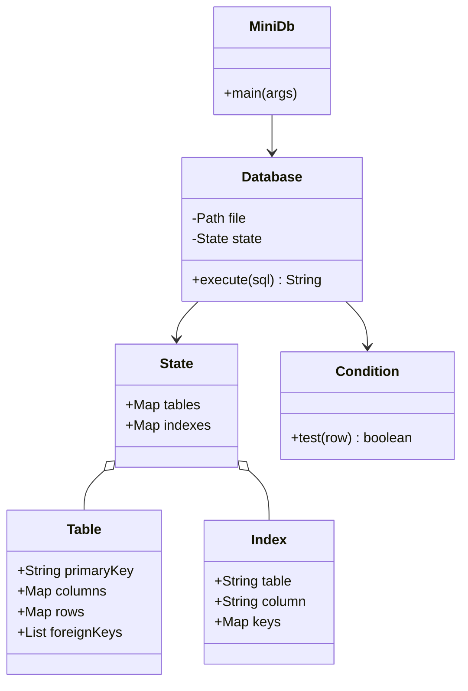
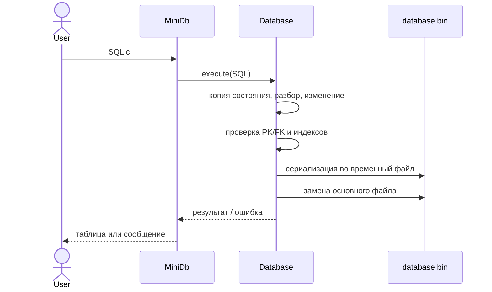

# MiniDb — СУБД на Java

Консольная программа хранит связанные таблицы в одном файле, принимает небольшое подмножество SQL и поддерживает сохраняемый индекс для поиска по равенству. Внешние библиотеки и сервер БД не требуются. Исходники совместимы с Java 8.

## Сборка и запуск

Нужен **JDK 8 или новее** (`javac` и `java`). Из корня проекта:

```text
javac -encoding UTF-8 -d out src/MiniDb.java src/MiniDbTest.java
java -cp out MiniDb
```

В Windows PowerShell можно выполнить `./build.ps1`: скрипт найдёт `javac` в `PATH` или в установленном JetBrains Runtime и соберёт байткод для Java 8. Это полезно, когда в `PATH` доступна только Java Runtime без компилятора. При ручной сборке на JDK 9+ добавьте `--release 8`, если результат должен запускаться на Java 8.

Для запуска в Windows PowerShell рекомендуется `./run.ps1`. Скрипт включает UTF-8 для консоли, поэтому русские строки в запросах и результатах отображаются корректно. Если рядом есть готовый `outputs/minidb-ru.jar`, он запустится; иначе скрипт сначала вызовет `build.ps1`. Можно указать файл базы: `./run.ps1 'data/my-database.bin'`.

По умолчанию данные находятся в `data/database.bin` относительно текущей папки. Можно передать свой путь: `java -cp out MiniDb path/to/database.bin`. Завершение: `EXIT`, `QUIT` или конец ввода. Каждый запрос заканчивается `;`; несколько законченных запросов можно ввести в одной строке.

Проверка: `java -cp out MiniDbTest`. Проверка с измерением производительности: `java -cp out MiniDbTest benchmark`. Тест создаёт временную БД и удаляет её после завершения.

## Данные и примеры команд

При первом запуске создаются пустые таблицы:

| Таблица | Поля | Ограничения |
|---|---|---|
| `manufacturers` | `brand STRING`, `country STRING`, `founded DATE` | `brand` — первичный ключ |
| `cars` | `id INT`, `brand STRING`, `price DOUBLE`, `available BOOLEAN` | `id` — первичный ключ; `brand` — внешний ключ на `manufacturers.brand` |

Сначала добавьте производителя, затем автомобиль:

```sql
INSERT INTO manufacturers VALUES ('Toyota', 'Japan', '1937-08-28'), ('BMW', 'Germany', '1916-03-07');
INSERT INTO cars VALUES (1, 'Toyota', 25000.0, TRUE);
INSERT INTO cars (id, brand) VALUES (2, 'BMW');
INSERT INTO manufacturers VALUES ('Лада', 'Россия', '1966-07-20');
INSERT INTO cars VALUES (3, 'Лада', 15000.0, TRUE);
SELECT * FROM cars;
SELECT brand, price FROM cars WHERE price > 20000;
UPDATE cars SET price = 30000 WHERE id = 2;
DELETE FROM cars WHERE brand = 'Toyota';
CREATE INDEX idx_cars_brand ON cars (brand);
SELECT * FROM cars WHERE brand = 'BMW';
```

Поддержаны `INSERT INTO` (одна или несколько записей), `SELECT`, `UPDATE`, `DELETE`, `CREATE INDEX`, `CREATE TABLE`, `DROP TABLE`. Дополнительная таблица:

```sql
CREATE TABLE owners (id INT PRIMARY KEY, name STRING, joined DATE,
                     car_id INT, FOREIGN KEY (car_id) REFERENCES cars(id));
INSERT INTO owners VALUES (1, 'Anna', '2026-11-12', 2);
DROP TABLE owners;
```

Типы: `INT`/`INTEGER`, `DOUBLE`/`FLOAT`, `STRING`/`TEXT`, `DATE` (`'YYYY-MM-DD'`), `BOOLEAN`/`BOOL` (`TRUE`/`FALSE`). Отсутствующие необязательные значения становятся `NULL`; первичный ключ не может быть `NULL`. Строки и даты записываются в одинарных кавычках. Одинарная кавычка внутри строки удваивается: `'O''Brien'`. Имена таблиц и столбцов приводятся к нижнему регистру.

`WHERE` содержит одно простое сравнение: `=`, `!=`, `<>`, `<`, `<=`, `>`, `>=`. Если `WHERE` нет, `UPDATE` и `DELETE` действуют на все записи. Индекс ускоряет `SELECT` только при `=` по индексированному полю; поиск по первичному ключу использует карту строк. `JOIN`, `AND`/`OR`, сортировка, агрегаты, изменения схемы и транзакции из нескольких команд не предусмотрены.

## Архитектура

`MiniDb.Database` выступает репозиторием: проверяет запрос, применяет изменение к копии состояния, проверяет первичные/внешние ключи и индексы, затем сохраняет снимок. Каждая отдельная команда — атомарная единица изменения в памяти. `Table` хранит строки в `LinkedHashMap<PK, Row>`, `Index` — отображение значения столбца в набор первичных ключей. При `SELECT` по индексированному столбцу читается этот набор; иначе перебираются строки.



Последовательность записи:



Сериализация выполняется через `ObjectOutputStream`. После записи вызывается `FileDescriptor.sync()`, затем временный файл в той же папке заменяет основной через `Files.move(..., ATOMIC_MOVE)`. Если файловая система не поддерживает атомарное перемещение, используется обычная замена; в этом случае защита от внезапного завершения слабее. Индексы сериализуются вместе с таблицами и проверяются при загрузке. Незавершённая команда не меняет уже сохранённый снимок. Открытие файла двумя процессами одновременно не поддерживается; данные следует считать локальными доверенными данными.

## Тестирование и производительность

`MiniDbTest` проверяет вставку нескольких строк, пять типов данных, `NULL`, выборку и условия, обновление/удаление, дубли первичного ключа, нарушения внешнего ключа, откат ошибочной команды, создание/удаление таблиц, восстановление данных и индекса после нового открытия файла, строки с запятой и точкой с запятой.

Созданы 10 000 автомобилей и 100 производителей. Выполнено по 400 одинаковых запросов `SELECT id FROM cars WHERE brand = 'Brand42'` (100 результатов на запрос), после прогрева по 20 запросов.

| Режим | 400 запросов | Ускорение |
|---|---:|---:|
| Полный перебор | 316,35 мс | 1× |
| Индекс `brand` | 31,51 мс | 10,04× |

На Java 8 Runtime тот же тест дал 273,43 мс без индекса и 89,80 мс с индексом (3,05×).

Это локальный микротест, а не гарантированная скорость: результаты зависят от JVM и компьютера. Создание индекса и запись файла в измерение SELECT не входят. Запуск `MiniDbTest benchmark` печатает результат для текущего компьютера.
